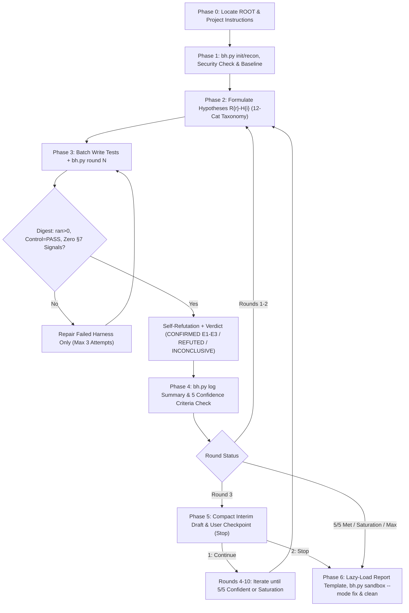

# VeriHunt 🎯🔍

[](https://agentskills.io)
[](https://github.com/lufus4826-eng/verihunt/releases/tag/v2.0.0)
[](LICENSE)
[](#installation--การติดตั้ง)
[](#supported-stacks--ภาษาและเครื่องมือที่รองรับ)
[](#how-to-invoke--ตัวอย่างคำสั่งใช้งาน)

> **VeriHunt v2.0 (formerly `bug-hunter`) — Evidence-Based Bug Hunting Agent Skill:** Hypothesize → Prove with real tests in an isolated sandbox → Refine across disciplined cycles → Deliver a verified Markdown report with regression tests and sandbox-proven diffs, without modifying your host codebase.
>
> **VeriHunt v2.0 (เดิมชื่อ `bug-hunter`) — สกิล AI Agent สำหรับไล่ล่าและพิสูจน์บัคด้วยหลักฐานจริง:** ตั้งสมมติฐาน → เขียนและรันเทสต์จริงในพื้นที่แยก → ต่อยอดรอบถัดไปอย่างมีวินัย → ส่งมอบรายงาน `.md` พร้อมชุด regression tests และวิธีแก้ที่ยืนยันใน sandbox แล้ว โดยไม่แตะโค้ดต้นฉบับแม้แต่บรรทัดเดียว

---

## ✨ What's New in v2.0 / มีอะไรใหม่ใน VeriHunt v2.0

VeriHunt v2.0 is a major architectural upgrade built from quantitative analysis of 94 historical bug-hunting transcripts and live blind-benchmark verification:

VeriHunt v2.0 เป็นการยกเครื่องสถาปัตยกรรมครั้งใหญ่จากข้อมูลการใช้งานจริง 94 transcripts และการทดสอบแบบ Blind Benchmark:

1. **Unified Bilingual Skill (`/verihunt`):** Merges `bug-hunter` (EN) and `bug-hunter-th` (TH) into one skill. VeriHunt automatically matches your prompt language (English or Thai) and lazy-loads only the matching report template (`resources/report-template.md` or `resources/report-template-th.md`) in Phase 6.
   - **รวมสกิล EN + TH เป็นหนึ่งเดียว (`/verihunt`):** ตอบรับและสร้างรายงานตามภาษาที่คุณพิมพ์สั่งงานโดยอัตโนมัติ (ไทยหรืออังกฤษ) โดยโหลดแม่แบบรายงานเฉพาะภาษาที่ต้องการใน Phase 6 เท่านั้น
2. **Deterministic Helper CLI (`scripts/bh.py`):** Standard-library Python 3 engine (zero external dependencies) that handles session setup, `<=35`-line project recon, cache/network isolation, parallel batch round runs, deterministic harness signal parsing (`§7`), `<=12`-line log digests, append-only `worklog.md` updates, and automated `sandbox-fix` + cleanup verification.
   - **เครื่องยนต์ CLI อัตโนมัติ (`scripts/bh.py`):** เขียนด้วย Python standard library ล้วน จัดการตั้งแต่สร้างเซสชัน, สแกนแผนที่โปรเจกต์แบบกระชับ, แยก cache/ปิดเน็ต, รันเทสต์ทั้งรอบ, สรุป log เหลือ ≤12 บรรทัด, อัปเดต `worklog.md` แบบต่อท้าย จนถึงจำลองการแก้ใน `sandbox-fix` และตรวจความสะอาดหลังจบงาน
3. **Token & Cost Guardrails:** Grep-first & `<=150`-line ranged reads, parallel batch test authoring per round, zero raw log dumps, single Phase 6 final report generation, and non-polling persistent-worker Team Mode (`bh.py check`).
   - **ประหยัดโทเคนและขั้นตอนลงกว่าครึ่ง:** บังคับ grep ก่อนอ่านแบบกำหนดช่วงบรรทัด, เขียนเทสต์ทั้งรอบพร้อมกันใน 1 turn, ไม่เปิดอ่าน raw log ดิบ, และห้าม polling loop ใน Team Mode

---

## 📊 Verified Benchmark Results (FinPay Blind Test) / ผลทดสอบวัดผลจริง

Measured end-to-end on the FinPay benchmark codebase comparing **v1 (`3018f54d`)** vs **VeriHunt v2.0 (`ddd4d0af` blind run, Thai report)**:

| Metric / ตัวชี้วัด | v1 (`bug-hunter`) | **v2.0 (`verihunt`)** | Improvement / ผลต่าง |
|---|---:|---:|---:|
| **Agent Steps** | 71 steps | **26 steps** *(28 incl. swarm posts)* | **−63.4%** |
| **Shell Commands (`run_command`)** | 34 | **18** | **−47.1%** |
| **Input Tokens** | 318,401 | **156,346** | **−50.9%** |
| **Cache Read Tokens** | 4,465,687 | **1,925,330** | **−56.9%** |
| **Total Tokens (In + Cache + Out)** | 4,847,030 | **2,166,364** | **−55.3%** |
| **Total Cost-eq** (`in + 0.1×cr + 5×out`) | 1,079,680 | **772,319** | **−28.5%** |
| **Hypotheses Tested** | 9 (3/round) | **15** (4–6/round) | **+66.7% deeper** |
| **Confirmed Bugs (`E1`)** | 6 (6/6 GT) | **13** (6/6 GT + 7 extra bugs!) | **+116.7% recall** |
| **Cost-eq per Hypothesis** | 119,964 | **51,488** | **−57.1%** |
| **Cost-eq per Confirmed Bug** | 179,947 | **59,409** | **−67.0%** |
| **Sandbox-Fix Verification** | 6/6 verified | **15/15 tests `ALL_PASS`** | **100% verified** |

Additional deterministic measurements from `scripts/bh.py` PowerShell verification:
- **CLI stdout reduction:** `4,206 B` across 10 `bh.py` lifecycle calls vs `63,101 chars` across 34 v1 shell commands (**−93.3%**).
- **Log digest compression:** `33,484 B` raw FinPay test logs compressed into `2,949 B` of deterministic digests (**−91.2%**).
- **Pre-Phase-6 active skill load:** **−43.4% bytes** (EN) / **−61.5% bytes** (TH) via compact core docs + lazy-loaded templates.

---

## ⚡ Quick Start / เริ่มต้นใช้งานด่วน

### Prerequisites / สิ่งที่ต้องมี
- **Python 3.9+** available as `python` (used by `scripts/bh.py`; standard library only, zero `pip` packages required).
- Target project's normal test toolchain (e.g., `pytest`, `node`, `go`, `mvn`/`gradle`, `dotnet`, `phpunit`, `cargo`).

### Installation / การติดตั้ง

#### 1. Claude Code
```bash
# User-global installation (Recommended / แนะนำ)
git clone https://github.com/lufus4826-eng/verihunt.git ~/.claude/skills/verihunt

# Or Project-level installation
git clone https://github.com/lufus4826-eng/verihunt.git .claude/skills/verihunt
```

#### 2. Google Antigravity / Gemini CLI
```bash
# Linux / macOS
git clone https://github.com/lufus4826-eng/verihunt.git ~/.gemini/config/skills/verihunt

# Windows (PowerShell)
git clone https://github.com/lufus4826-eng/verihunt.git "$HOME\.gemini\config\skills\verihunt"
```
> **Upgrading from v1 (`bug-hunter` / `bug-hunter-th`)?** Remove the old `bug-hunter` and `bug-hunter-th` skill folders after cloning `verihunt` so your agent always loads the unified v2.0 skill.

#### 3. Cursor / Windsurf / Roo Code / Cline / Other Agent Runtimes
Clone into your agent's skills directory:
```bash
git clone https://github.com/lufus4826-eng/verihunt.git .agents/skills/verihunt
```

---

## 💡 How to Invoke / ตัวอย่างคำสั่งใช้งาน

VeriHunt automatically matches the language of your prompt (**English** or **Thai**):

```text
# English prompt -> English updates & English final report (resources/report-template.md)
/verihunt
/verihunt audit src/api for concurrency bugs and run until confident without asking
/verihunt hunt security and edge-case defects in the billing and checkout modules

# Thai prompt -> Thai updates, Thai Phase 5 checkpoint & Thai report (resources/report-template-th.md)
/verihunt
/verihunt หาบัคในโมดูล billing และ checkout
/verihunt audit src/api ตรวจความเสถียร วนจนมั่นใจเลยไม่ต้องถาม
```

---

## 🏗️ Methodology & Architecture / หลักการและสถาปัตยกรรม

### Supreme Principle / กติกาสูงสุด
> **English:** A test FAIL caused by harness/environment breakdown is NOT a bug. A test PASS that never executes target code is NOT correctness. Obeying the letter of rules while violating intent is a violation.
>
> **ภาษาไทย:** เทสต์ที่ FAIL เพราะ harness หรือสภาพแวดล้อมพัง **ไม่ใช่บัค** และเทสต์ที่ PASS โดยไม่เคยรันโค้ดเป้าหมายจริง **ไม่ใช่ความถูกต้อง** การทำตามตัวอักษรแต่ฝ่าฝืนเจตนารมณ์ถือว่าผิดกติกา

### Disciplined Loop (Phases 0–6) / ขั้นตอนการทำงาน 0–6



| Phase | Purpose (EN) | หน้าที่หลัก (TH) |
|---|---|---|
| **Phase 0** | Locate `ROOT` & read existing agent rules (`CLAUDE.md`, `GEMINI.md`, `.cursorrules`, `CONTRIBUTING.md`) | หา `ROOT` และอ่านไฟล์กติกาของโปรเจกต์ที่มีอยู่ (ไม่สร้างไฟล์ใหม่) |
| **Phase 1** | `bh.py init` + `recon`, pre-execution `.env`/hook security check, load matching `lang/<stack>.md`, run `baseline` | สร้างเซสชันและ snapshot, ตรวจความปลอดภัยก่อนรัน, โหลดคู่มือเฉพาะภาษา และรัน baseline |
| **Phase 2** | Formulate 3–7 concrete hypotheses ordered by `Probability × Impact` against `bug-taxonomy.md` (12 categories) | ตั้งสมมติฐาน 3–7 ข้อที่ผูกกับตำแหน่งโค้ดจริง โดยอิง `bug-taxonomy.md` 12 หมวด |
| **Phase 3** | Trace full path, write all round tests in parallel, execute `bh.py round`, validate harness & self-refute guards | ไล่ path จริง, เขียนเทสต์ทั้งรอบพร้อมกัน, รัน `bh.py round`, ตรวจ harness และหา guard หักล้าง |
| **Phase 4** | Log verdicts via `bh.py log`, check 5 Confidence Criteria, chain next round (siblings, propagation, interaction bugs) | บันทึกผลผ่าน `bh.py log`, เช็กเกณฑ์ความมั่นใจ 5 ข้อ และแตกสมมติฐานต่อยอด |
| **Phase 5** | Mandatory stop after Round 3 with compact `<=25`-line interim `bug-report.md` and Continue/Stop prompt | หยุดถามหลังจบรอบ 3 พร้อมรายงานฉบับระหว่างทางแบบกระชับ ให้ผู้ใช้เลือกว่าจะวนต่อหรือสรุป |
| **Phase 6** | Lazy-load EN or TH report template, verify diffs in `sandbox-fix`, write 9-section report, run `bh.py sandbox --mode clean` | โหลดแม่แบบรายงาน EN/TH, ยืนยันวิธีแก้ใน `sandbox-fix`, เขียนรายงาน 9 ส่วน และล้างไฟล์ชั่วคราว |

### Verification Guarantees / กลไกป้องกันผลลวงและยืนยันความถูกต้อง
- **Evidence Hierarchy (`E1`–`E3`):** `E1` Reproduced via real failing test (required for `CONFIRMED` unless technically unrunnable) > `E2` Runtime observation > `E3` Static code trace.
- **Deterministic Harness Validation (`00-common.md` §3 / §7):** `bh.py` rejects empty runs (`ran == 0`), missing imports, syntax/compile errors, setup fixture crashes, and Node TAP `MODULE_NOT_FOUND` (which exits `1` just like assertion failures!) so broken harnesses are never counted as bugs.
- **Mandatory Control Tests:** Every test file must include `>=1` passing control test (`test_control_*` / `Control_*`) proving the target code path executes cleanly on valid input; `bh.py` isolates leaf names so `test_access_control_bypass` is never mistaken for a control test.
- **Concurrency Race-Window Widening:** Replaces external collaborators (repos/caches/HTTP) with `1–5 ms` latency fakes and barrier-synchronized bursts (`50–200` runs, reporting exact `k/N` hit ratios) instead of false-negative tight loops.
- **Sandbox-Fix Verification:** `bh.py sandbox --mode fix` clones the repo into `S/sandbox-fix/` and replicates `S/tests/`, applies proposed unified diffs, runs `bh.py round --all --fix` (confirming FAIL → PASS) + `baseline_fix`, and reports `"Verified in Sandbox"` before any host file is touched.

---

## 🛠️ `scripts/bh.py` Engine Reference / คู่มือคำสั่งเครื่องยนต์ `bh.py`

| Subcommand | Purpose |
|---|---|
| `init [--root .]` | Creates `.bughunt/<YYYYMMDD-HHMMSS>/{tests,logs,tmp}` + `.cache`, captures `fs-before.txt` snapshot, initializes `worklog.md`, prints 1-line JSON `{S, SNAME, CACHE, ROOT, snapshot, prior_sessions}`. |
| `recon [--root .]` | Emits a `<=35`-line project map (instruction files, languages, manifests, entrypoints, existing tests, LOC by directory, `TODO`/`FIXME` hits, git churn & fix commits). |
| `run --s S --tid TID -- <cmd>` | Executes command with cache/offline/UTF-8 env vars, writes raw output + `exit=<code>` to `S/logs/<TID>.log`, and prints a `<=12`-line digest (`ALL_PASS` \| `VALID_BUG_FAIL` \| `HARNESS_BROKEN` \| `TIMEOUT` \| `EXEC_ERROR`). |
| `round --s S (--round N \| --all) [--fix]` | Auto-discovers round tests (`test_r{N}_h*`, `BugHuntR{N}H*`, `bughunt_r{N}_h*`), runs them, and outputs a compact round summary table (`--fix` targets `S/sandbox-fix/` and writes `<TID>_fix.log`). |
| `check --s S (--tid TID \| --round N \| --all)` | *(Alias `digest`)* Re-parses existing `S/logs/*.log` deterministically without re-running (used in Team Mode verdict validation). |
| `log --s S [--status ...] [--entry ...]` | Atomically updates line-1 `Status:` of `S/worklog.md` and appends entries without rewriting the full file. |
| `sandbox --s S --mode create\|fix\|clean` | Copies clean project sandbox (preserving `vendor/`, skipping `.git`/caches/build dirs), replicates tests for `sandbox-fix`, or cleans temp dirs, archives sandbox tests, and diffs `fs-before.txt` vs `fs-after.txt`. |

---

## 💻 Supported Stacks / ภาษาและเครื่องมือที่รองรับ

| Language | Test Runners & Parsers in `bh.py` | Isolation Strategy | OS Support |
|---|---|---|:---:|
| **Python** | `pytest` (incl. `SUBFAILED`), `unittest` | `PYTHONDONTWRITEBYTECODE=1`, `-p no:cacheprovider`, `PYTHONUTF8=1` | ✅ Win / Mac / Linux |
| **JS / TS** | `node --test` (TAP), `jest`, `vitest`, `mocha` | `npx --no-install`, `.bughunt/.cache/` overrides | ✅ Win / Mac / Linux |
| **Go** | `go test` (incl. `-race` `DATA RACE`) | `S/sandbox/` copy, `GOCACHE`, `GOPROXY=off` | ✅ Win / Mac / Linux |
| **Java / Kotlin** | Maven Surefire, Gradle (`gradlew` / `gradle`) | `S/sandbox/` copy, `mvn -o`, `gradle --offline` | ✅ Win / Mac / Linux |
| **C# (.NET)** | `dotnet test` (xUnit, NUnit, MSTest) | `S/sandbox/` copy, `--no-restore`, telemetry opt-out | ✅ Win / Mac / Linux |
| **PHP** | `phpunit` | `vendor/` preserved, `--do-not-cache-result --no-coverage` | ✅ Win / Mac / Linux |
| **Rust** | `cargo test` | `S/sandbox/` copy, `CARGO_TARGET_DIR`, `--offline --locked` | ✅ Win / Mac / Linux |

---

## 📦 Output Deliverables & Repository Structure / สิ่งที่ส่งมอบและโครงสร้างคลังโค้ด

### Session Artifacts (`.bughunt/<YYYYMMDD-HHMMSS>/`)
```text
.bughunt/20261115-185306/
├── bug-report.md         # Final 9-section verified Markdown report (EN or TH)
├── worklog.md            # Append-only state journal & hypothesis verdicts (resumable)
├── tests/                # Standalone regression tests (FAIL before fix / PASS after fix)
└── logs/                 # Raw execution logs, exit codes & fs-before/fs-after snapshots
```
> 💡 **Tip:** Never commit `.bughunt/` (logs may contain sensitive stack traces). Add `.bughunt/` to `.git/info/exclude` or `.gitignore`.

### Repository Layout (`verihunt/`)
```text
verihunt/
├── SKILL.md                          # Unified bilingual master prompt & token guardrails
├── README.md                         # Bilingual documentation & benchmark results
├── CONTRIBUTING.md                   # Contributor guidelines (EN + TH)
├── LICENSE                           # MIT License
├── scripts/
│   └── bh.py                         # Deterministic stdlib Python helper CLI (v2.0)
└── resources/
    ├── report-template.md            # 9-section report template — English (Phase 6 lazy-load)
    ├── report-template-th.md         # 9-section report template — Thai (Phase 6 lazy-load)
    ├── bug-taxonomy.md               # 12-category defect taxonomy checklist
    ├── team-mode.md                  # Non-polling multi-agent rules (>=50k LOC)
    └── lang/                         # Compact language isolation adapters
        ├── 00-common.md              # bh.py CLI spec, offline rules, §7 signals, concurrency
        ├── python.md                 # Python pytest / unittest adapter
        ├── js-ts.md                  # Node TAP / Jest / Vitest / Mocha adapter
        ├── go.md                     # Go sandbox & race detector adapter
        ├── jvm.md                    # Java / Kotlin Maven & Gradle adapter
        ├── dotnet.md                 # C# .NET adapter
        ├── php.md                    # PHP PHPUnit adapter
        └── rust.md                   # Rust Cargo sandbox adapter
```

---

## ⏪ Rollback to v1 (`v1.0-legacy`) / การย้อนกลับไปใช้เวอร์ชันเดิม

The original v1 `bug-hunter` skill commit is permanently preserved under the `v1.0-legacy` tag:

โค้ดเวอร์ชัน v1 (`bug-hunter`) ถูกเก็บสำรองไว้อย่างถาวรภายใต้ git tag ชื่อ `v1.0-legacy`:

```bash
# Switch an existing clone back to v1.0-legacy
git fetch --tags
git checkout v1.0-legacy

# Or clone v1.0-legacy directly
git clone --branch v1.0-legacy --depth 1 https://github.com/lufus4826-eng/verihunt.git ~/.gemini/config/skills/bug-hunter
```

---

## 🤝 Contributing & License / ร่วมพัฒนาและใบอนุญาต

- Contributions are welcome! See [CONTRIBUTING.md](CONTRIBUTING.md) for adapter, `bh.py`, and taxonomy guidelines.
- Licensed under the **MIT License** — see [LICENSE](LICENSE).
