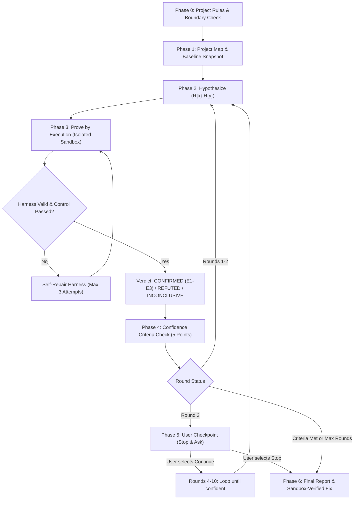

# Bug Hunter 🎯🔍

[](https://agentskills.io)
[](LICENSE)
[](#installation)
[](#supported-stacks)

> **Evidence-Based Bug Hunting Agent Skill:** Hypothesize → Prove with real tests in an isolated sandbox → Refine across disciplined cycles → Deliver a verified Markdown report with regression tests and sandbox-proven diffs, without modifying your host codebase.
>
> **สกิล AI Agent สำหรับไล่ล่าและพิสูจน์บัคด้วยหลักฐานจริง:** ตั้งสมมติฐาน → เขียนและรันเทสต์จริงในพื้นที่แยก → ต่อยอดรอบถัดไปอย่างมีวินัย → ส่งมอบรายงาน .md พร้อมชุด regression tests และโค้ดแก้ไขที่ยืนยันใน sandbox โดยไม่แตะโค้ดต้นฉบับแม้แต่บรรทัดเดียว

---

## ⚡ Quick Start / เริ่มต้นใช้งานด่วน

### Installation / การติดตั้ง

#### 1. Claude Code
```bash
# User-global installation (แนะนำ)
git clone https://github.com/lufus4826-eng/bug-hunter.git ~/.claude/skills/bug-hunter

# Or Project-level installation
git clone https://github.com/lufus4826-eng/bug-hunter.git .claude/skills/bug-hunter
```

#### 2. Google Antigravity / Gemini CLI
```bash
# Linux / macOS
git clone https://github.com/lufus4826-eng/bug-hunter.git ~/.gemini/config/skills/bug-hunter

# Windows (PowerShell)
git clone https://github.com/lufus4826-eng/bug-hunter.git "$HOME\.gemini\config\skills\bug-hunter"
```

#### 3. Cursor / Windsurf / Roo Code / Cline / Agent Runtimes
Clone into your agent's skills or instructions directory:
```bash
git clone https://github.com/lufus4826-eng/bug-hunter.git .agents/skills/bug-hunter
```

---

## 💡 How to Invoke / ตัวอย่างคำสั่งใช้งาน

In your AI agent chat, invoke via slash command or natural prompt:

```text
# เรียกใช้งานเต็มระบบ
/bug-hunter

# ระบุโมดูลและเงื่อนไขเฉพาะ
/bug-hunter หาบัคในโมดูล billing และ checkout
/bug-hunter audit src/api ตรวจความเสถียร วนจนมั่นใจเลยไม่ต้องถาม
/bug-hunter hunt concurrency and memory leaks in the authentication service
```

---

## 🏗️ Core Architecture & Disciplined Loop / สถาปัตยกรรมการทำงาน



---

## 🛡️ Core Guarantees / จุดเด่นและกติกาความปลอดภัย

| Guarantee | English | ภาษาไทย |
|---|---|---|
| **Proof by Execution** | Every claim requires reproducible test output (`E1 Reproduce > E2 Runtime > E3 Trace`). Speculations are rejected. | ตัดสินด้วยผลรันจริงเท่านั้น ไม่คาดเดาจากความรู้สึก |
| **Zero Footprint** | All test scripts, logs, and sandbox copies live in `.bughunt/`. No modifications to host code, lockfiles, or config. | ไฟล์ทุกอย่างอยู่ใน `.bughunt/` ไม่แตะโค้ดหรือสภาพแวดล้อมโปรเจกต์ |
| **False-Positive Prevention** | Mandatory control tests and strict harness validation (Import errors and empty runs are never counted as bugs). | บังคับมี Control Test และตรวจ Harness ก่อนสรุป กันการนับ ImportError หรือคำสั่งที่ไม่ได้รันจริงเป็นบัค |
| **Sandbox Fix Verification** | Proposed diffs are applied in `sandbox-fix/` to confirm that failing tests turn PASS before user review. | ลอง apply diff ใน sandbox-fix แล้วรันเทสต์จริงยืนยันก่อนส่งมอบ |
| **Git Safety** | Workspace snapshot before & after. Strict prohibition against destructive `git reset`, `clean`, or `checkout`. | เก็บ Snapshot ก่อน-หลัง ห้ามใช้คำสั่ง git ที่ทำลายงานที่ค้างไว้ |
| **Cross-Platform Native** | Full dual-syntax support: Linux/macOS (**Bash**) and Windows (**PowerShell**). | รองรับคำสั่งสมบูรณ์ทั้ง Bash และ PowerShell บน Windows |

---

## 💻 Supported Stacks / ภาษาและเครื่องมือที่รองรับ

| Language | Test Runners & Harness | Isolation Strategy | Dual Syntax Support |
|---|---|---|:---:|
| **Python** | `pytest`, `unittest` | `PYTHONDONTWRITEBYTECODE=1`, `-p no:cacheprovider` | ✅ Bash / PowerShell |
| **JS / TS** | `node:test`, `jest`, `vitest`, `mocha` | `npx --no-install`, isolated cache dir | ✅ Bash / PowerShell |
| **Go** | `go test` (built-in race detector) | Sandbox copy (`GOCACHE`, `GOPROXY=off`) | ✅ Bash / PowerShell |
| **Java / Kotlin** | Maven Surefire, Gradle | Sandbox copy (`mvn -o`, `gradle --offline`) | ✅ Bash / PowerShell |
| **C# (.NET)** | `dotnet test` (xUnit, NUnit, MSTest) | Sandbox copy (`--no-restore`, telemetry opt-out) | ✅ Bash / PowerShell |
| **PHP** | `phpunit` | `vendor/` autoload, `--do-not-cache-result` | ✅ Bash / PowerShell |
| **Rust** | `cargo test` (safe / release overflow) | Sandbox copy (`CARGO_TARGET_DIR`, `--offline --locked`) | ✅ Bash / PowerShell |

---

## 📦 Output Deliverables / สิ่งที่ส่งมอบเมื่อตรวจเสร็จ

When a bug hunt completes, you get a self-contained, audit-ready package in `.bughunt/<session>/`:

```text
.bughunt/20261105-143005/
├── bug-report.md         # Final comprehensive Markdown report (ตามแม่แบบมาตรฐาน)
├── worklog.md            # Real-time state journal & hypotheses history (ทำต่อได้เมื่อ context หลุด)
├── tests/                # Standalone reproduction & regression test suite (FAIL ก่อนแก้ / PASS หลังแก้)
└── logs/                 # Raw execution logs containing actual stack traces & exit codes (หลักฐานจริง)
```

> 💡 **Tip:** Add `.bughunt/` to your `.git/info/exclude` or `.gitignore` to prevent committing session test logs to version control.

---

## 📂 Repository File Structure / โครงสร้างโฟลเดอร์ในคลังโค้ด

```text
bug-hunter/
├── SKILL.md                      # Master skill prompt & process rules (275 lines)
├── README.md                     # Documentation & usage guide
├── LICENSE                       # MIT License
├── CONTRIBUTING.md               # Guidelines for contributors
├── .gitignore                    # Safe gitignore rules
├── .gitattributes                # Line ending normalizations
└── resources/
    ├── report-template.md        # Standardized Markdown report template
    ├── bug-taxonomy.md           # 12-category defect taxonomy checklist
    ├── team-mode.md              # Multi-agent / subagent dispatch guidelines
    └── lang/                     # Language-specific isolation adapters
        ├── 00-common.md          # Shared Bash/PowerShell commands, log capture, harness signals
        ├── python.md             # Python pytest/unittest adapter
        ├── js-ts.md              # JavaScript / TypeScript adapter
        ├── go.md                 # Go sandbox & race detection adapter
        ├── jvm.md                # Java / Kotlin Maven & Gradle adapter
        ├── dotnet.md             # C# .NET adapter
        ├── php.md                # PHP PHPUnit adapter
        └── rust.md               # Rust Cargo sandbox adapter
```

---

## 🤝 Contributing / ร่วมพัฒนา

Contributions are welcome! Please read [CONTRIBUTING.md](CONTRIBUTING.md) for guidelines on adding language adapters, refining bug taxonomy checklists, or contributing edge-case regression examples.

---

## 📜 License / ใบอนุญาต

This project is licensed under the **MIT License** - see the [LICENSE](LICENSE) file for details.
